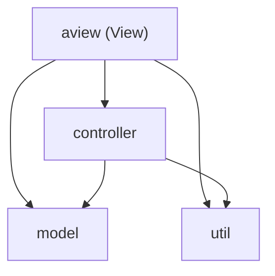

# Architecture

Crownfall follows a strict **layered MVC architecture**. Each layer only depends on the layers below it.

| Package | Responsibility | May depend on |
|---|---|---|
| `model` | Game data and rules. Completely immutable. | — |
| `util` | Generic building blocks without game logic | — |
| `controller` | Holds the current game state, executes commands, notifies observers | `model`, `util` |
| `aview` | User interface: input, rendering, messages | `controller`, `model`, `util` |
| `Main` | Creates and wires all components | everything |

Upward dependencies and cycles between packages are not allowed.

## Design Decisions

- **Immutable model.** Every action returns a new board instead of changing the existing one. The only mutable state is the reference to the current board in the `Controller`.
- **Observer pattern.** The controller notifies registered views after every change without knowing them. New views can be added without changing the controller.
- **Commands belong to the controller.** `Command` lives in `controller`, not in the view, to avoid a cycle between both layers.
- **Errors as types.** The model reports errors as `GameError`. Turning them into text for the player is the responsibility of the view.

## Design Patterns

| Pattern | Classes | Problem it solves |
|---|---|---|
| **Observer** | `util.Observable`, `util.Observer`, `Tui` | The controller notifies views about changes without knowing them. |
| **Strategy** | `model.DamageStrategy`, `RatioDamage`, `TrueDamage`; used by `Board.attack` | The damage formula is exchangeable. The strategy is chosen in `Main` and passed to the `Controller`. A new formula does not change `Board`. |
| **State** | `model.GameState`, `Turn`, `GameOver`; held by `Controller` | Whether a troop may act depends on the phase of the game. Each state answers this itself (`check`) and decides which state follows (`next`). The controller has no `if` for the game phases. |
| **Template Method** | `aview.tui.Renderer`, `PlainRenderer`, `ColorRenderer` | Drawing the board always follows the same steps (`final def render`). Subclasses only decide how a troop is drawn (`troopCell`). Replaces a boolean color flag. |
| **Chain of Responsibility** | `model.Rule` and its rules; chains `Board.moveRules`, `Board.attackRules` | Each rule of `move` and `attack` is its own object. The action is passed along the chain until the first rule reports an error. A new rule, e.g. for terrain, is added to the list without changing `move`. |

Strategy, State and Chain of Responsibility share the same structure (a trait with several implementations) but differ in purpose: a strategy is **chosen from outside**, a state **chooses its successor itself**, and in a chain **all handlers are asked in turn** until one stops the action.

## Verification

The layer rules are checked automatically by the ArchUnit tests in `ArchitectureSpec`.