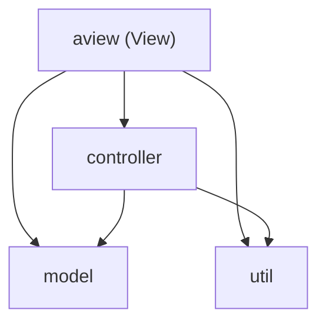

# Architecture

Crownfall follows a strict **layered MVC architecture**. Each layer only depends on the layers below it.

| Package | Responsibility | May depend on |
|---|---|---|
| `model` | Game data and rules. Completely immutable. | — |
| `util` | Generic building blocks without game logic | — |
| `controller` | Holds the current game state, executes commands, notifies observers | `model`, `util` |
| `aview` | User interface: input, rendering, messages | `controller`, `model`, `util` |
| `Main` | Creates and wires all components | everything |

Upward dependencies and cycles between packages are not allowed.

## Design Decisions

- **Immutable model.** Every action returns a new board instead of changing the existing one. The only mutable state is the reference to the current board in the `Controller`.
- **Observer pattern.** The controller notifies registered views after every change without knowing them. New views can be added without changing the controller.
- **Commands belong to the controller.** `Command` lives in `controller`, not in the view, to avoid a cycle between both layers.
- **Errors as types.** The model reports errors as `GameError`. Turning them into text for the player is the responsibility of the view.

## Verification

The layer rules are checked automatically by the ArchUnit tests in `ArchitectureSpec`.